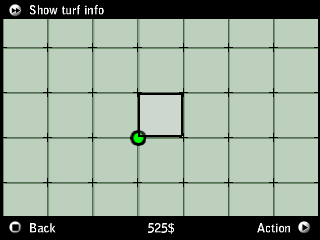

# Validation de la connexion et de la reconnexion

Le jeu Colors patché pour déverrouiller Turf War a été exécuté intégralement dans PocketHLE CLI avec le moteur Unicorn. Un adaptateur de test fournit un vrai transport HTTP local et des fixtures pour le GPS (Paris) et le fond GIF 315×225. Cet adaptateur ne fait pas partie du serveur livré.

Le parcours a atteint la création du joueur, la validation GPS, la carte et le menu Buy Turf sans crash. Un second lancement, après arrêt du jeu et du serveur, retrouve le profil et revient directement sur la carte sans saisir à nouveau le nom. Les commandes observées sont exactement : getgamevars, synctimestamps, getuserinfo, getmapview. Aucun dissolvegang, removeplayer ou setuserinfo. Le nom, l’argent virtuel, l’appartenance, l’état enregistré et le compteur de modifications du profil sont conservés. Le processus émulateur termine proprement.

## Cause du problème apparent de reconnexion

L’ancien banc d’essai conservait Save mais pas le fichier config.cfg situé dans \Flash Disk\MyGames\GZGA200015 Colors\. Le code original à 0x184c0 teste TWPlayerValid=1. Si cette valeur manque, la branche à 0xdd984 déclenche le parcours de remise à zéro, dont dissolvegang puis removeplayer. Le callback d’enregistrement à 0xe6df4 appelle 0x18280 pour écrire TWPlayerValid=1, puis 0xa02c0 sauvegarde config.cfg.

Le banc d’essai conserve désormais tout Flash Disk, comme PocketHLE desktop. Après l’enregistrement, le déchiffrement du fichier généré confirme TWPlayerValid=1. Cela résout la reconnexion sans changer la sémantique de removeplayer sur le serveur. Le registre Gizmondo seul n’est pas la cause.

Les 18 tests serveur passent, dont un test de reconnexion après réouverture de SQLite qui conserve le profil et le crew. Les vérifications avec les routines ARM originales couvrent également l’horloge GPS1, les commandes chiffrées, le premier turf, les métadonnées et le décodeur GIF/CDATAs.

Les tests ne valident pas une partie complète avec deux clients graphiques, le transport Windows/Android, une vraie position hôte, le téléchargement OSM dans le parcours intégral, ni une construction Docker ou une exécution physique sur Synology.

